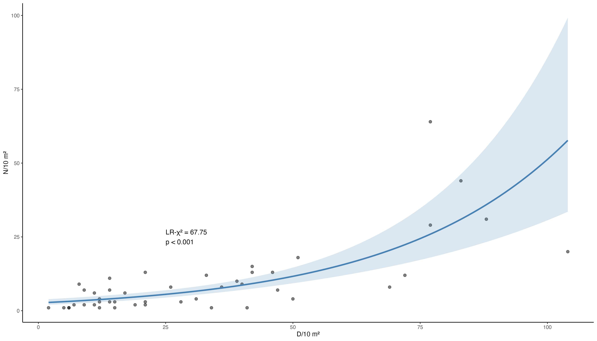

```{r}
#| label: Options
### Customized R options for this document
# Delete this chunk if you don't use R

# Necessary packages. Add all packages used in the code here.
packages_required <- c(
  # R tools, do not modify
  "knitr",   # to run the code chunks
  "formatR", # if tidy = TRUE below
  # Add specific packages here
  "tidyverse", 
  "gt",
  "katex"
)
# Already installed?
packages_installed <- vapply(
  packages_required, 
  FUN = requireNamespace, 
  FUN.VALUE = TRUE, 
  quietly = TRUE
) 
# Install missing packages
install.packages(
  names(packages_installed)[!packages_installed],
  repos = "https://cran.rstudio.com/",
  quiet = TRUE
)

# Allow size='small' or any valid Latex font size in chunk options
def.chunk.hook <- knitr::knit_hooks$get("chunk")
knitr::knit_hooks$set(
  chunk = function(x, options) {
    x <- def.chunk.hook(x, options)
    ifelse(
      options$size == "normalsize", 
      yes = x,
      no = paste0("\n \\", options$size, "\n\n", x, "\n\n \\normalsize")
    )
  }
)

# knitr options (https://yihui.org/knitr/options/)
knitr::opts_chunk$set(
  # Code chunk automatic format if tidy is TRUE
  tidy = TRUE, 
  # Tidy code options: remove blank lines and cut lines after 50 characters
  tidy.opts = list(blank = FALSE, width.cutoff = 50),
  # Font size in PDF output
  size = "scriptsize", 
  # Select PDF figures in PDF output if PDF file exists beside PNG file
  knitr.graphics.auto_pdf = TRUE
)
# Text width of R functions output
options(width = 50)

# ggplot style
library("tidyverse")
# Function to call in each chunk that produces a figure
ggtheme_set <- function() {
  theme_set(theme_bw())
  theme_update(
    panel.background = element_rect(fill = "transparent", colour = NA),
    plot.background = element_rect(fill = "transparent", colour = NA)
  )
}
knitr::opts_chunk$set(dev.args = list(bg = "transparent"))

# Random seed
set.seed(973)
```

# Introduction

Logging is one of the greatest pressures on the forests of French Guiana (**check bibli**). It accounts, however, for a significant proportion of the territory’s economy, 100 M€ of turnover in 2024, and is set to increase in order to meet the population’s growing demand for timber ([Rapport IDIOM Guyane 2024](https://www.iedom.fr/IMG/rapport_annuel_iedom_guyane_2024/#p=104)). In order to reconcile the exploitation of timber resources with the conservation of the Amazon rainforest, the ONF (Office national des Forêts françaises) and the timber industry have worked to establish low-impact logging practices by drafting the ‘Low-Impact Logging Charter (EFI)’ in 2010, which was revised in 2016 ([Observatoire des forêts françaises](https://observatoire.foret.gouv.fr/themes/les-forets-de-guyane)). This low-impact logging or reduced impact logging (RIL) ([FAO, 2003](https://www.fao.org/4/ae164E/ae164E00.htm)) method can be defined as “Intensively planned and carefully controlled implementation of harvesting operations to minimize the impact on forest stands and soil, usually in individual tree selection cutting” ([Killmann and al, 2001](https://www.cabidigitallibrary.org/doi/full/10.5555/20033009016)). To be considered sustainable, this type of harvesting in French Guyana must prevent biodiversity loss and limit the pressure of harvesting on the most sensitive species. Consequently, the trees to be felled are selected on the basis of the sensitivity of the target species and the tree’s position within the stand. For example, Dicorynia guianensis trees with a diameter of more than 100 cm are not harvested in order to preserve the main reproductive plants. On average, 5 stems are harvested per hectare, although this varies depending on the abundance of the plot ([Charte d’exploitation à faible impact, 2017](https://www.onf.fr/produits-services/+/1d98::charte-pour-une-exploitation-faible-impact-efi-en-guyane.html)). However, RIL does have a significant impact on forest dynamics by altering forest microclimates, species composition and increased mortality rates of trees damaged in logging ([Schulze and al, 2006](https://www.sciencedirect.com/science/article/abs/pii/S0378112706008462)). However, little is known about how these interventions affect the regeneration dynamics of the tree species exploited. The study of Wernsdorfer shows by modelisation that logging seems to affect more the population size of the tree species exploited  than the genetic diversity.  They also underline the importance of carrying out further research into demographic processes such as juvenile mortality, in particular to better assess changes in genetic diversity. Finally, he emphasises that forest management should pay particular attention to the regenerative capacity of exploited species ([Wernsdörfer and al, 2011](https://link.springer.com/article/10.1007/s10592-009-9983-0)). 

In French Guyana, Dicorynia guianensis Amshoff (Fabaceae) is one of the most exploited species  which in recent years has accounted for more than half of the volume of timber harvested (PRFB, 2019).  This species is mainly used for joinery, cabinet-making, parquet flooring and port construction ([Flora 2018](https://theses.hal.science/tel-02368310v1)). However, beyond its economic importance, D. guanensis plays a major ecological role. It is a species endemic to the Guiana Shield, forming the backbone of low-altitude rainforests and, as a hyperdominant species, playing a major role in the carbon cycle ([Fauset and al, 2015](https://www.nature.com/articles/ncomms7857)). Consequently, its harvesting does have an impact on forest dynamics. According to the ONF’s charter on low-impact harvesting (2017), harvesting pressure affects 25 per cent of the population of this species. Despite its current, rather reassuring conservation status, due in particular to its wide range ([Falcao and al, 2022](https://www.researchgate.net/profile/Marcus-Falcao/publication/361821500_A_Taxonomic_Revision_of_the_Amazonian_Genus_Dicorynia_Fabaceae_Dialioideae/links/62d38ccafd347a451bc47cf2/A-Taxonomic-Revision-of-the-Amazonian-Genus-Dicorynia-Fabaceae-Dialioideae.pdf)), the significant pressure from deforestation on the D. guanensis population, as well as its high vulnerability to drought, may have a long-term impact on the regeneration of this species. In particular, reduced growth during the dry season, low resistance to embolism, and difficulty in maintaining cell turgor in this commercial species could impact its ability to survive in the environment and meet growing timber demand ([Fortunel et al](https://nph.onlinelibrary.wiley.com/doi/full/10.1111/nph.18973)., 2023; [Maréchaux et al., 2015](https://besjournals.onlinelibrary.wiley.com/doi/full/10.1111/1365-2435.12452); [Ziegler et al., 2019](https://link.springer.com/article/10.1007/s13595-019-0905-0)). Indeed, climate forecasts by Météo France, based on the latest work of the IPCC (CMIP6) and local climate data, conclude in particular that there will be an increase in the intensity of dry seasons with an increase in temperatures and the duration of this period and a decrease in rainfall ([Météo France, Projection climatique sur la Guyane](https://meteofrance.gf/fr/climat/changement-climatique-en-guyane-les-projections-guyaclimat)). 

Therefore, this study aims to investigate the impact of logging on the long-term regeneration capacity of D. guyanensis. The regeneration of a tree population can be defined as the set of demographic processes that ensure the renewal of individuals, from the seed dispersed during the fruiting of a tree to the recruitment of a new adult capable of reproducing. The recruitment of new reproductive adults is thus limited by two main factors. First, it depends on the local supply of seeds, via fecundity and dispersal, and on seedling survival. Second, it depends on the distribution and quality of microsites favorable to the growth of established life stages (Gesel, 2005). In this study our objective is to focus on two important elements of recruitment: the survival in the establishment phase, therefore the survival of juveniles and seedlings, and the influence of micro-habitats favorable to this establishment and survival. Indeed, the first stages of a tree life are the most vulnerable to mortality (Gesel, 2005). At the seedling stage, the most important factor of mortality is the sensitivity to biotic agents (pathogens, predators, parasites), the risk caused by branch fall and the drought tolerance because seedlings have short roots and can not search water in depth ([Kitajima et Fenner 2000](https://www.cabidigitallibrary.org/doi/abs/10.1079/9780851994321.0331), [Baraloto C. 2003](https://hal.science/hal-03449467)). For juveniles established, stage after seedlings, the most important driver of survival is the presence of favorable microsites that allow a great growth, especially the presence of light ([Brokaw and Scheiner 1989](https://www.jstor.org/stable/1940196)). Here, we define seedlings like a young growing plant that has not yet eliminated the causes of biotic mortality and is therefore not perfectly established : it is in the establishment time. We define a juvenile as a young plant whose survival increasingly depends on growth in favorable microsites : it is in the exploration phase (Gesel, 2005). These definitions can be summarised in the following representation inspired by Rollet, 1969.Therefore, in this study we will answer the following questions : 

- How logging influences the forest microclimate ? Does logging openings create different abiotic conditions according to natural openings ? How do these environmental conditions change in time ?

- Does these microclimate differences influence the number of seedlings and juveniles starting the installation phase in a site ? 

- How are the mortality of seedlings and juveniles impacted by logging and how does the mortality rate evolve in time after logging and during the different season ?\

To answer these questions, we compare environmental variables and regeneration dynamics of D. guyanensis on plots recently exploited 2 years ago (in 2024), 6 years ago (in 2020) with plots of unexploited natural forest closed or with a natural opening. We compare the number of seedlings starting the installation phase between all the different logging conditions and therefore climatic conditions present in each site. The climatic conditions measured are light condition, humidity of soil and air, temperature of soil and air. We also compare the probability of survival of the seedlings and juveniles according to their diameter, their herbivory rate, the density of seedlings per plot (10m2) and the logging conditions. In this study, we will not discriminate juveniles from seedlings directly because there is no morphological information in the literature that allows us to do this clear differentiation. But we expected a differential influence of the herbivory rate and the climatic conditions in the probability of survival according to the diameter of the seedlings as explained before. 

Therefore in this study we hypothesise that logging creates lighter, hotter and less humid conditions than non logged forest. Even if we do not have any information about the soil properties we expect more soil compaction for logged forest because of the passage of machinery. We expect that probably the natural gap condition creates a similar climatic condition that of ones created by logging. But the differentiation of soil compaction could impact the number of seedlings able to germinate and start the installation phase in logged condition compared with natural gap. Finally, we assume that for the site that was logged 6 years ago, a dynamic of closure is taking hold creating less light, hot and more humid conditions than for the site logged 2 years ago. In this study we do not have information of the parents of the juveniles and seedlings follow. But the sites were chosen to be similar in terms of reproduction capacity. Therefore, we posit that the seed banks of D. guyanensis seeds are similar in all the conditions and reproduction is not actually the main driver of the differentiation (citer l’article de Julien) in the variables studied. We know that in early stage of development D. guyanensis could be considered as a light species, shade tolerant which can germinate in gaps under forest cover ([Baraloto, 2001](https://www.proquest.com/openview/38ac3602b3fcd2caa03c24e95323d347/1?cbl=18750&diss=y&loginDisplay=true&pq-origsite=gscholar)). Following the results of [Bonnier and al (2026)](https://peercommunityjournal.org/articles/10.24072/pcjournal.779/) and Gesel (2005), we advocate that in natural gaps, gaps created by logging and on the logging trails we will observe more seedlings that have germinated than in closed no disrupted forest thanks to the favorable climatic conditions which reduce the competition for ressources. But, Gésel (2005) also showed that for areas exploited a long time ago, the number of seedlings could be less important than the ones in non-disturbed forest in the gaps, and the number of juveniles can decrease compared with non-disturbed forest because of more damage soil condition (erosion, loss of organic matter and minerals). So, we will tend to confirm these tendencies. However, an opposed hypothesis could be posed, Baraloto (2001) showed that abiotic factors of the micro-environment have little influence on germination if predators are controlled. Therefore, we may not observe impacts of climatic conditions on the seedlings' presence. 

For the mortality study, we expected a decrease of mortality with the increase of the seedlings and juveniles diameter (Gesel).  Here diameter is used as a proxy of the development stage, seedlings with bigger diameter of the stem are in more advanced stages of development. Therefore, the smaller diameter (inferior to 1.8 mm according to Gesel study) represents seedlings while the bigger diameter (between 1.8  and 10.3 mm according to Gesel study) represents juveniles. Also, as presented before, we suppose that the mortality of seedlings are more influenced by herbivory of their leaf whereas the mortality of juveniles are more dependent on climatic conditions. According to that, we expected less mortality of juveniles in open areas than in closed areas. For seedlings,[Basset and al (2002)](https://besjournals.onlinelibrary.wiley.com/doi/full/10.1046/j.1365-2664.2001.00660.x) show that openings created by logging increased the abundance of herbivores in French Guyana, therefore we expect more mortality on logged areas than on no disrupted forest. But they also show that the main driver of this increase in insect abundance depends more on the presence of young foliage produced by seedlings than of the opening canopy. So if we observe more seedlings in natural gaps, mortality of seedlings could also be impacted the same way. To complete, [Darrigo and al (2017)](https://onlinelibrary.wiley.com/doi/abs/10.1111/btp.12483) show also a very interesting pattern which is that the effect of logging on biotic interactions can extend beyond the gaps it creates into untouched understory sites. Therefore, because our sites of study are not that far (add the exact distance) we can maybe observe similar patterns of herbivory in non logged and logged areas. To finish, we also consider the dependent density effect from Janzen Connell. Janzen and Conell explained that the density of predators increases with the density of the available resource. But Gesel shows that the opening of the canopy appears to compensate for the density-dependent mortality of juveniles, as they can more easily compensate for damage sustained. But for seedlings we expected more sensibility. Finally for older logging conditions, we expected higher mortality because of a stronger inter-specific competition from heliophil species. 

To conclude our goal is to discriminate the strategies of regeneration of D. guianensis under logged and unlogged conditions. (we can detailed)  

# Materials and methods {#markdown}

## Experimental design

## Variable measured

## Models construction

### Seedlings' germination and installation during the rainy season according to logging conditions and the density of seedlings and juveniles already installed.

First, we compare the number of seedlings and juveniles which germinated between march and September 2026 per plot of 10 m2 according to the logging modalities, qualitative variable with 4 modalities : logged in 2020, logged in 2024, non logged closed forest, natural gap. Secondly, we analyse the same response variable according the density of seedlings and juveniles already installed in the site. Since our response variable is a counting data point we proceed to two negative binomial generalised linear model, because the variance was bigger than the mean, with the function `glm.nb` from the package *mass*. The overdispersion of the model was checked by the function `check_overdispersion` from the *performance* package. The best model was selected as the one minimizing the Akaike Information Criterions (AIC) and the residual deviance. The contribution of the selected factors to the structuring of the studied variables was evaluated by a type II ANOVA using the `Anova` function from the *car* package. The first model is mathematically presented by the @eq-1, and the second model by the @eq-2: $$log(\mu_i) = \mu_0 + \alpha_i + \epsilon_i $$ {#eq-1}

With $\mu_i$ corresponding to average number of new seedlings and juveniles for the modality i of logging, $\mu_0$ average number of new seedlings and juveniles for the modality of reference, $\alpha_1$ differential effect of the logging conditions on the number of new seedlings and juveniles per plots, $\epsilon_i$ residuals error following a normal low $N = (0, \sigma^2)$.

$$log(\mu_i) = \beta_0 + \beta_1.x_i + \epsilon_i $$ {#eq-2}

With $\mu_i$ corresponding to the number of new seedlings and juveniles for the plot i, $\beta_0$ intercept of the regression, $\beta_1$ density effect on the number of new seedlings and juveniles per plots, $\epsilon_i$ residuals error following a normal low $N = (0, \sigma^2)$.

The average number of new individuals per plot, for each logging condition studied, was estimated using the `emmeans` function from the package *emmeans*. Then, the comparison of the values ​​obtained two by two was carried out by the post-hoc tukey test with the `pairs` function of the *emmean* package.

#### Diameter and height of new seedlings according logging conditions

To determine if the height and the diameter of the new seedlings and juveniles recently installed vary between the logging modalitites we first carried out a Kruskal Wallis test with the `kruskal.test` function of the *rstatix* package. After we realized the post hoc Wicoxon test with the `pairwise_wilcox_test` from the *rstatix* package to compare the effect of logging modality two by two.

### Seedlings and juveniles' mortality according to logging conditions

We study the probability of survival of the seedlings and juveniles according to 4 fixed effects : their diameter (quantitative variable), the logged condition (quantitative variable with 4 modalities : logged in 2020, logged in 2024, non logged closed forest, natural gap), their herbivory rate (quantitative variable) and the density of seedlings per plot (quantitative variable). We also consider the plot modality as variable with random effect. We conduct a generalised linear mixed model (GLMM) with a logit link function with the function `glmer` of the *lme4* package. As for the model presented below, the overdispersion was checked with `check_overdispersion` from the *performance* package. The best model was selected as the one minimizing the Akaike Information Criterions (AIC) and the residual deviance. The contribution of the selected factors to the structuring of the studied variables was evaluated by a type II ANOVA using the `Anova` function from the *car* package.

In this model, the best model was the one with only the logging modalities and the diameter of the seedlings and juveniles with no interactions between the two modalities @eq-3: 

$$logit(S_{ik}) = \beta_0 + \alpha_i +\beta_{diameter} . x_k + u_{plot} +\epsilon_{ik} $$ {#eq-3}

With $S_{ik}$ probability of survival of seedlings or juveniles k for the i modality of logged variable, $\beta_0$ intercept of the regression, $\alpha_i$ differential effect of i modality of the logged variable on the probability of survival, $\beta_{diameter}$ effect of the diameter of the seedlings or juveniles k on its probability of survival, $u_{plot}$ random effect of plots on the probability of survival, $\epsilon_{ik}$ residuals error following a normal law $N(0,\sigma^2)$. 

The average probability of survival of seedlings and juveniles for each logging condition studied, was estimated using the `emmeans` function from the package *emmeans*. Then, the comparison of the values ​​obtained two by two was carried out by the post-hoc test with the `pairs` function of the *emmean* function. For the impact of the diameter, we checked the `summary` of the model to obtain the estimate of the parameter.

### Net increase of population density of seedlings and juveniles according to the logging condition

To conclude our study we analysed the average net increase of the seedlings population according to the different logging modalities. The net increase of the population of seedlings per plot was obtained by the number of new seedlings per plots minus the number of dead seedlings per plot during the period September 2025 - September 2026. Because we only have the number of new seedlings per plot for the period march 2026 - September 2026 we extrapolated linearly to obtain the number of the seedlings for one year, by multiplying by two the number of seedlings measured for the period march 2026 - September 2026. Then, we realized a linear model with a Welch correction with the `oneway.test` function of the *stats* package. The post hoc test was realized by the `pairxise_t_test` student test with a holm correction on the p-value. The model equation is the following ones :

$$Y_i = \mu + \alpha_i + \epsilon_i$$ {#eq-4}

With $Y_i$ corresponding to average net increase of seedlings population during the past year for the modality i of logging, $\mu$ average net increase of new seedlings and juveniles for the modality of reference, $\alpha_i$ differential effect of the logging conditions on the net increase of seedlings and juveniles population per plots, $\epsilon_i$ residuals error following a normal low $N = (0, \sigma^2)$.

# Results

### Seedlings' germination and installation during the rainy season according to logging conditions and the density of seedlings and juveniles already installed.

The model 1 allowed to significantly reduce the residual deviance compare to the null model (Likelihood Ratio Test: χ² = 21.47, df = 2, p \< 0.001). The logging modalities have a significant impact on the number of new seedlings that germinated between march and September in a given plot (**N/10 m²)**. The average number of new seedlings per plot predicted by the model is presented in the Figure 1. The plots logged in 2024 present a higher number of new seedlings -30 new seedlings per plot estimated - than the on logged in 2020 - 6.82 new seedlings per plot estimated - (z.ratio = -3.661, p-value = 0.0007) and the control plots - 6.07 new seedlings per plot estimated - (z.ratio = -4.514, p-value \<0.0001). No difference of the number new seedlings have been seen between the plots logged in 2020 and the control ones (z.ratio = -0.386, p-value = 0.9213).

::: {#fig-1}
```{r}
#| label: Figure 1
#| out-width: 30%

```

**Effect of** **logging modalities on the number of newly emerged seedlings between March and September (N/10 m²).** Large colored points represent model-estimated mean new seedling abundance, and error bars indicate the corresponding 95% confidence intervals. Small grey points represent individual observed values. Different letters indicate statistically significant differences between logging modalities.
:::

The model 2 showed that the density of conspecific seedlings (D/10m2) and juveniles per plot also have a significant impact on the number of new seedlings germinating (N/10m2) ($Deviance_0$ = 112.946, $Deviance_{mod}$ = 45.193 , p-value \< 2.2 e-16). The figure 2 shows the relation between the two variables. The higher the density of seedlings is, the higher the number of new seedlings is. With the summary of the model 2, the estimate of the density effect ( $\beta_1$ ) is 0.02962. Considering the logarithm link function associated with the negative binomial model, we can therefore said that the increase of 1 seedlings per plot is associated with an increase of 3,01% of the mean value expected for the number of new seedlings per plot.

::: {#fig-2}
```{r}
#| label: Figure 2
#| out-width: 80%

 

```

**Effect of pre-existing seedling and juvenile density (March 2026; D/10 m²) on the number of newly emerged seedlings between March and September 2026 (N/10 m²).** Grey points represent the observed data. The blue line shows the model-predicted relationship, and the shaded light-blue area represents the corresponding 95% confidence interval.
:::

#### Height and diameter of the new seedlings

Seedling diameter and height differed significantly among logging modalities (Kruskal–Wallis tests: diameter, χ² = 70.57, p \< 0.001; height, χ² = 32.13, p \< 0.001). Pairwise Wilcoxon tests (Table 1) showed that seedlings in plots logged in 2024 had significantly larger diameters than those in plots logged in 2020 and control plots. Seedlings in plots logged in 2020 also had larger diameters than those in control plots. Regarding height, seedlings in both logged treatments were significantly taller than those in control plots, with no significant difference between the 2020 and 2024 logging treatments (p-value = 0.20).

::: {#tbl-1}
```{r}
#| label: Table 1

```

**New seedlings characteristics and comparison between logging modalities.** Values are medians \[Q1–Q3\]. Different letters indicate significant differences between logging modalities based on pairwise Wilcoxon tests with Holm correction (p \< 0.05)."
:::

### Seedlings and juveniles' mortality according to logging conditions

The best-fitting model explaining seedling and juvenile mortality (Pm) included logging treatment and diameter as additive effects, with no interaction. Neither herbivory nor seedling density significantly improved model fit. The effect of logging treatment on mortality probability is presented in `fig-3`. Mortality probability was significantly lower in plots logged in 2024 than in both plots logged in 2020 and control plots (p \< 0.0001). However, no significant difference in mortality probability was detected between plots logged in 2020 and control plots (p = 0.6). Mortality probability also decreased significantly with increasing seedling and juvenile diameter (χ² = 52.319, p \< 0.0001). Specifically, each one-unit increase in diameter was associated with an approximately 30.5% decrease in the odds of mortality, regardless of logging treatment.

::: {#fig-3}
```{r}
#| label: Figure 3
#| out-width: 80%
ggplot(Fig4, aes(x = Logging, y = prob)) +geom_point( aes(color = Logging),size = 3.5 ) +
  geom_errorbar( aes( ymin = asymp.LCL,ymax = asymp.UCL,color = Logging ),
    width = 0.15,linewidth = 0.8) +
  geom_text( aes(y = y_letter, label = .group), color = "black",fontface = "bold",  size = 5 ) +
  scale_color_manual( values = c( "CONTROL" = "grey50", "EX_2020" = "#377EB8", "EX_2024" = "#238B45" )) +
  labs( x = NULL, y = "Pm",color = "Logging") +
  scale_y_continuous(expand = expansion(mult = c(0.05, 0.18))) +
  theme_minimal(base_size = 14)


```

**Effect of logging treatment on the probability of mortality (Pm) among seedlings and juveniles.** Large colored points represent the model-estimated probabilities of mortality for each logging treatment, and error bars indicate the corresponding 95% confidence intervals.
:::

### Net increase of population density of seedlings and juveniles according to the logging condition

First, one observation from the 2024 logging treatment was excluded from the analysis because it had a strong influence on the model (leverage \> 1), possibly due to the extrapolation described in the Materials and Methods section. Welch's ANOVA revealed a significant effect of logging treatment on the net increase in seedling and juvenile population (F = 6.9, p = 0.014). Post hoc comparisons indicated a tendency towards a greater net increase in plots logged in 2024 than in plots logged in 2020 and control plots, although these differences were not statistically significant (p = 0.061 and p = 0.057, respectively). No significant difference was detected between plots logged in 2020 and control plots (p = 0.116). These results are presented in `fig-4`.

::: {#fig-4 fig-env="figure*"}
```{r}
#| label: Figure 4
#| out-width: 80%

pw = pairwise.t.test(x = pop_increase_raw_bis$Net_increase,g = pop_increase_raw_bis$Logging,p.adjust.method = "BH",pool.sd = FALSE)

pw_df = as.data.frame(as.table(pw$p.value)) %>% filter(!is.na(Freq)) %>%rename( group1 = Var1,group2 = Var2,p.adj = Freq)

p_values = pw_df$p.adj
names(p_values) <- paste(pw_df$group1, pw_df$group2, sep = "-")

letters_df = multcompView::multcompLetters( p_values, threshold = 0.05)$Letters

letters_df = data.frame( Logging = names(letters_df),letters = unname(letters_df))

y_range = diff(range(pop_increase_raw_bis$Net_increase, na.rm = TRUE))

positions = pop_increase_raw_bis %>%group_by(Logging) %>%summarise( y.position = max(Net_increase, na.rm = TRUE) + 0.08 * y_range,.groups = "drop")

letters_df = left_join(letters_df, positions, by = "Logging")

# Graph
ggplot(pop_increase_raw_bis, aes(x = Logging, y = Net_increase, fill = Logging)) +geom_boxplot( outlier.shape = NA, alpha = 0.8, width = 0.6, colour = "grey30" ) + geom_jitter(  width = 0.12, alpha = 0.65, size = 1.8, colour = "grey65") +
  geom_text(data = letters_df,aes(x = Logging, y = y.position, label = letters),inherit.aes = FALSE,size = 5) +
  scale_fill_manual( values = c(  "CONTROL" = "grey50", "EX_2020" = "#377EB8", "EX_2024" = "#238B45")) +
   scale_y_continuous(expand = expansion(mult = c(0.05, 0.15)) ) +
  labs( y = "Net increase", x = NULL ) +
  theme_light()

```

**Net change in seedling population density according to logging treatment.** Small grey points represent individual observations. Boxplots show the median (central line), the interquartile range , and the whiskers indicate the data range excluding outliers. Different letters indicate statistically significant differences between logging treatments (BH-adjusted pairwise comparisons, p \~ 0.05).
:::

# Discussion

# Conclusion

## Cross-references

Figures and tables have a label declared in their division `tbl-xxx` or `tbl-xxx`, starting with `fig-` or `tbl-`.

For equations, the label is added manually by the code `{#eq-xxx}` after the end of the equation.

Sections can be tagged by ending their title with `{#sec-yyy}`.

In all cases, the call to the reference is made by `@`.

# Bibliography

Bibliographic references included in the `.bib` file declared in the document header can be called by `[@CitationKey]`, in parentheses [@Xie2018], or without square brackets, in the text, as @Xie2016.

The bibliographic style can be specified, by adding the line

```         
csl: file_name.csl
```

in the document header and copying the *.csl* style file to the project folder. More than a thousand styles are available[^1] and their URL can be used instead of copying the file, e.g.:

[^1]: <https://github.com/citation-style-language/styles>

```         
csl: https://www.zotero.org/styles/xxx
```

## Forcing line breaks

Hyphenation is handled automatically in LaTeX. If a word is not hyphenated correctly, add its hyphenation in the preamble of the file with the command `hyphenation` (words are separated by spaces, hyphenation locations are represented by dashes).

If LaTeX can't find a solution for the line break, for example because some code is too long a non-breaking block, add the LaTeX command `\break` to the line break location. Do not leave a space before the command. The HTML document ignores LaTeX commands.

## Languages

Languages are declared in the document header.

The main language of the document (`lang`) changes the name of some elements, such as the table of contents. The change of language in the document (one of `otherlangs`) is managed in LaTeX (but not fully in HTML).

For a single word, to ensure correct hyphenation in LaTeX, use the following command, ignored un HTML:

```         
\foreignlanguage{italian}{ciao}
```

For a paragraph, to also ensure correct quotes and punctuation spacing, use

```         
::: {lang=fr}
"Bonjour": en français!
:::
```

to obtain:

::: {lang="fr"}
"Bonjour": en français!
:::

The current language has an effect only in LaTeX output: a space is added before double punctuation in French, the size of spaces is larger at the beginning of sentences in English, etc.

## Text color

This template includes the "color-text" filter for Quarto. It makes colored text possible using the `[content]{color=<name>}` syntax. [This is a red example]{color="red"}. Defined colors are blue, green and red. To add more colors, they must be defined in the document header in `format:`, `stylisharticle-pdf:`, `header-includes:` . This is the code for "grey":

```         
    \definecolor{grey}{RGB}{191, 191, 191}
```

They must also be included in a `.css` file declared in `format:`, `stylisharticle-html:`

```         
    css: colors.css
```

In this css, colors are declared by

```         
.color-grey {color: rgb(191, 191, 191);}
```

# .gitignore

Copy this content to the `.gitignore` file:

```         
# RStudio files and folders
.Rproj.user
.Rhistory
.RData
.Ruserdata

# Mac OS
.DS_Store

# Output
/*.html
/*.pdf
/*.tex
# Intermediate files
/nul
/*.aux
/*.log
/*.toc
# Working folders
/*_files/
/*_cache/

# Template (copied from _extensions)
/stylisharticle.cls
```

# GitHub Action

Create a file named `quarto_publish.yml` in the folder `.github/workflows` (to be created) to activate continuous integration:

```         
on:
  push:
    branches: [main, master]

name: Render and Publish

jobs:
  build-deploy:
    runs-on: macOS-latest
    permissions:
      contents: write
    steps:
      - name: Check out repository
        uses: actions/checkout@v7
      - name: Set up R
        uses: r-lib/actions/setup-r@v2
      - name: Set up Quarto
        uses: quarto-dev/quarto-actions/setup@v2
        env:
          GH_TOKEN: ${{ secrets.GITHUB_TOKEN }}
        with:
          tinytex: true
      - name: Install dependencies
        run: |
          options(pkgType = "binary")
          options(install.packages.check.source = "no")
          install.packages(c("rmarkdown", "knitr"))
        shell: Rscript {0}
      - name: Publish to GitHub Pages
        uses: quarto-dev/quarto-actions/publish@v2
        with:
          path: index.qmd
          target: gh-pages
        env:
          GITHUB_TOKEN: ${{ secrets.GITHUB_TOKEN }}
```

# Caveats

Quarto does not yet support all features of R Markdown. Unsolved issues are listed here, as of version 1.9:

- The `column` options in code chunks or `{.column-xxx}` div's can't be used in this template. They interfere with the two-column LaTeX layout. The template relies on other techniques to print full-width figures and tables.

# Annexes
